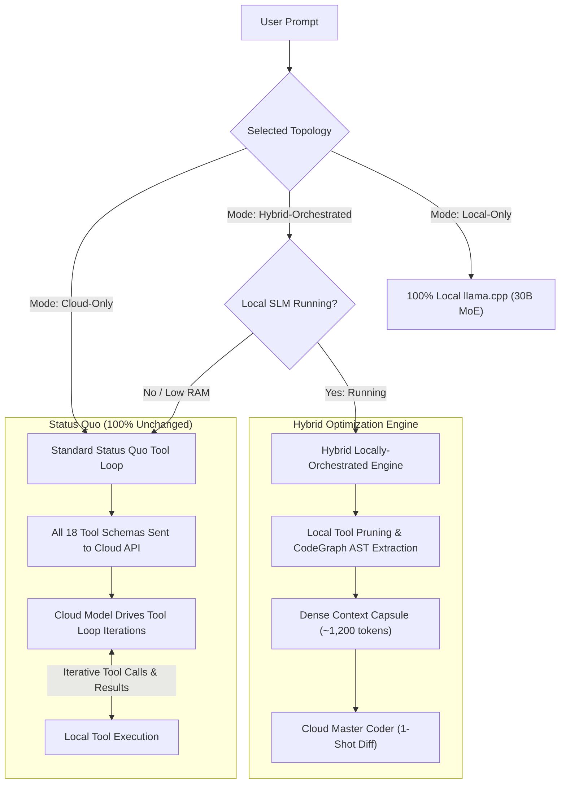

# Complete Master Implementation Plan: Vendored llama.cpp & Adaptive Hybrid AI Engine

> **Status:** Ready for Implementation  
> **Target Release:** Mugil IDE v0.5.0  
> **Monorepo Packages:** `@mugil-ide/core`, `mugil-ide` (CLI & Web IDE)  
> **Core Tenets:**  
> 1. **Zero Regression on Cloud-Only Status Quo:** If the user does not want to run a local LLM, tool orchestration with online API models operates 100% identically to how it does today.  
> 2. **Permanent Multi-Provider Freedom:** Ollama and LM Studio are NOT deprecated and NOT sunset.  
> 3. **90%+ Token Efficiency in Hybrid Mode:** 1-shot error-free code execution with local pre-flight.  
> 4. **Guaranteed Process Teardown:** Unified Kill Server contract with zero orphaned processes.

---

## 1. Executive Summary & Core Invariants

This plan establishes a high-performance local AI runtime and token-efficient hybrid orchestration engine in [Mugil IDE](file:///home/plasma/Documents/pyscripts/IDE/README.md).

### 🛡️ The Non-Negotiable Invariant: Zero Change to Cloud-Only Status Quo
If the user chooses **`Cloud-Only Mode`** (or has not installed/started a local model):
* **Zero local models or background daemons are spawned.**
* **Zero CPU overhead, zero port scans, zero RAM consumption.**
* **Tool orchestration operates 100% identically to the existing system:**
  - The cloud model (Claude, GPT-4o, DeepSeek, etc.) receives all declared tools in full.
  - The cloud model drives the multi-turn tool loop autonomously across sequential turns.
  - The existing [`ToolLoop`](file:///home/plasma/Documents/pyscripts/IDE/packages/core/src/modules/tool-loop/index.ts) executes tool calls, returns results, and repeats until completion.
  - The new local pre-flight and pruning modules are **completely bypassed** via a single guard:
    ```ts
    if (topology === 'cloud-only' || !this.localLlamaManager?.isRunning()) {
      // Execute the exact existing status-quo ToolLoop path
      return this.executeStandardToolLoop(messages, options);
    }
    ```

---

## 2. The Three User-Selected Topologies

Mugil IDE supports three distinct operating topologies, fully selectable via the top navigation ribbon, CLI flags, or `.env`:

```
┌───────────────────────────────────────────────────────────────────────────┐
│                      MUGIL IDE TOPOLOGY SELECTOR                         │
├───────────────────────────────────────────────────────────────────────────┤
│ ☁️ [Cloud-Only]              100% Status Quo. Direct online API tool loop. │
│                             Zero local processes, zero local RAM.         │
├───────────────────────────────────────────────────────────────────────────┤
│ ⚡ [Hybrid-Orchestrated]     Local SLM (1.5B) handles discovery & pruning.│
│    (Recommended for Laptops)Cloud model writes code in 1-shot (90% savings│
├───────────────────────────────────────────────────────────────────────────┤
│ 💻 [Local-Only]              100% Local Inference (30B MoE llama.cpp).    │
│    (Workstations >=16GB VRAM)Zero cloud egress, 100% airgap privacy.      │
└───────────────────────────────────────────────────────────────────────────┘
```



---

## 3. Permanent Multi-Provider Freedom (Ollama & LM Studio)

> [!IMPORTANT]
> **Zero Sunsetting Policy**
> Ollama and LM Studio are **NOT deprecated and NOT sunset**.
> They remain permanent, first-class supported providers in the Web UI and CLI. Users who already have Ollama or LM Studio configured can continue using them indefinitely with zero friction.

The built-in vendored `llama.cpp` runtime is positioned as an **instant zero-setup option for users who have nothing installed**, not as a forced replacement for existing setups.

---

## 4. Risk 1–3 Engineering Mitigations

### Risk 1: The "Misguided Scout" (Local Model Gathers Incomplete Context)
* **Mitigation:**
  1. **Deterministic CodeGraph Anchor:** The local model does not guess filenames. [`queryCodeGraph`](file:///home/plasma/Documents/pyscripts/IDE/packages/core/src/modules/codegraph/index.ts#L403) performs lexical and symbol matching to produce the top-5 candidates. The local model only acts as a re-ranker.
  2. **Open-Door Prompt Contract:** The Context Capsule sent to the cloud model explicitly includes:
     > *"Pre-flight discovered symbols [A, B]. If you require additional files to complete this task safely, call `read_file`."*
  3. **Blast Radius:** If pre-flight misses a file, the cloud model falls back to standard tool calling. Zero broken code, zero regression.

### Risk 2: Over-Aggressive Tool Pruning
* **Mitigation:**
  1. **The Immutable Core:** `read_file` and `edit_file` are **never pruned under any circumstances**.
  2. **Rule-Based Co-requisite Tool Bundles:** Tools are grouped into deterministic clusters:
     - `CORE_EDITING`: `['read_file', 'edit_file', 'apply_patch']` *(Always Active)*
     - `TERMINAL`: `['run_command', 'read_terminal']` *(Active if prompt mentions test/build/run or files are modified)*
     - `EXPLORATION`: `['list_files', 'grep_search', 'find_files']` *(Active if CodeGraph confidence score < 15)*
     - `MEDIA`: `['generate_image', 'read_blob']` *(Active only if media explicitly requested)*
     - `EXTENSIONS`: `['dispatch_webhook', 'mcp_tool_execute']` *(Active only if configured)*

### Risk 3: Memory Pressure on Tight 8 GB RAM Laptops
* **Mitigation:**
  1. **Dynamic RAM Gating:** Before launching `llama-server`, check `os.freemem()`:
     ```ts
     if (os.totalmem() <= 8 * 1024 * 1024 * 1024 || os.freemem() < 1.5 * 1024 * 1024 * 1024) {
       // Bypasses llama-server; engages 0-RAM Algorithmic Pre-Flight Mode
     }
     ```
  2. **0-RAM Algorithmic Pre-Flight Fallback:**
     - Regex tool bundle pruning: **0 MB RAM, < 1ms CPU**.
     - Lexical CodeGraph extraction: **~20 MB RAM**.
     - Caveman linguistic refinement: **0 MB RAM**.
     - Delivers **~75% token savings** with **zero memory pressure and zero risk of disk swap thrashing**.

---

## 5. Token Counting & Savings Counter Overhaul

### Deficiencies in Current Implementation
1. **Distorted Mathematical Denominator:**
   In [`packages/core/src/savings.ts`](file:///home/plasma/Documents/pyscripts/IDE/packages/core/src/savings.ts), `inputSavingsPercent` computes `saved / (saved + kept) * 100`. `keptTokens` only records compressed prompt and raw tool output, ignoring system prompts and history. When Ponytail output avoidance is added to `optimisticTokensSaved` (`agentRepl.ts:1664`), an output-side metric is evaluated against an input-only denominator, producing artificial spikes.
2. **Missing Architectural Buckets:**
   `SavingsBreakdown` only contains `{ caveman, yagni, cache, mcp }`, missing:
   * **`toolPruning`**: 3,000–5,000 tokens of JSON schema saved per turn.
   * **`hybridRecon`**: 15,000–30,000 tokens of exploratory tool loops avoided by local pre-flight.

### The Overhaul Implementation
```ts
// packages/core/src/types.ts
export interface SavingsBreakdown {
  caveman: number;      // Prompt & history linguistic compression
  yagni: number;        // AST skeletons (read_skeleton) & output minimization
  cache: number;        // Exact & semantic cache hits
  mcp: number;          // RTK log deduplication & output truncation
  toolPruning: number;  // [NEW] Schema tokens saved by dynamic tool pruning
  hybridRecon: number;  // [NEW] Cloud exploration tokens avoided via local CodeGraph
}
```

* **Normalized Efficiency Formula:**
  $$\text{Realized Savings \%} = \frac{\text{DirectSaved} + \text{AvoidedRecon}}{\text{DirectSaved} + \text{AvoidedRecon} + \text{ActualBilledTokens}} \times 100$$
  This ensures savings are bounded in $0\text{--}99\%$ and mathematically reflect actual financial savings on provider bills.

---

## 6. Master File Structure & Component Map

```
packages/core/src/
├── modules/
│   ├── llamacpp/                      # Vendored llama.cpp Runtime
│   │   ├── paths.ts                   # appDataDir, modelsDir, vendorDir, pidFile
│   │   ├── hardware.ts                # probeHardware + evaluateHardware (Tiers 1-3)
│   │   ├── catalog.ts                 # Pinned MODEL_CATALOG + recommendModels
│   │   ├── download.ts                # Streaming download + SHA256 + Range resume
│   │   ├── binary.ts                  # Pinned b12451 asset unpack + chmod (~35 libs)
│   │   ├── server.ts                  # LlamaServerManager supervisor + PID reaper
│   │   ├── models.ts                  # Local .gguf discovery & path traversal guards
│   │   └── index.ts                   # Public exports
│   ├── hybrid/                        # [NEW] Locally-Orchestrated Hybrid Engine
│   │   ├── types.ts                   # DenseContextCapsule & ToolBundle interfaces
│   │   ├── toolPruner.ts              # Bundle-based tool schema pruning (Risk 2)
│   │   ├── codeDiscovery.ts           # Lexical CodeGraph + AST extraction (Risk 1)
│   │   ├── contextCapsule.ts          # Capsule synthesis & prompt formatter
│   │   └── orchestrator.ts            # Pre-flight coordinator with RAM gating (Risk 3)
│   ├── security/
│   │   ├── secretVault.ts             # Ephemeral token vault
│   │   ├── secretScanner.ts           # Regex/entropy scanner
│   │   └── semanticPrivacyGuard.ts    # [NEW] Local SLM-powered DLP scanner
│   └── codegraph/                     # Codebase AST knowledge graph
├── token/
│   └── tokenizer.ts                   # Calibrated token estimation
├── savings.ts                         # [REFACTOR] Corrected savings formulas & breakdown
└── pipeline.ts                        # [MODIFY] Local pre-flight hook (Bypassed if Cloud-Only)

packages/cli/src/
├── shutdown.ts                        # Unit-testable deadline-bounded shutdown
├── providers.ts                       # llamacpp provider def (Ollama & LM Studio permanent)
├── server/
│   ├── server.ts                      # /api/llamacpp/* routes + loopback base-var gate
│   └── html.ts                        # UI ribbon topology selector + Welcome modal
└── terminal/
    └── agentRepl.ts                   # Stats tracking overhaul (toolPruning + hybridRecon)
```

---

## 7. Phased Task-by-Task Implementation Steps

### Task 1: Token & Savings Counters Overhaul
- [ ] In `packages/core/src/types.ts`: Add `toolPruning: number` and `hybridRecon: number` to `SavingsBreakdown`.
- [ ] In `packages/core/src/savings.ts`: Update `defaultSavingsBreakdown()`, `sumSavingsBreakdowns()`, and implement `calculateSessionEfficiency(saved, kept, actualBilled)`.
- [ ] In `packages/cli/src/terminal/agentRepl.ts`: Update `/stats` display and API endpoint to track and render the new categories.

### Task 2: Core Hardware & Path Foundations
- [ ] Create `packages/core/src/modules/llamacpp/paths.ts`: Root paths at `dirname(userEnvPath())`, with `MUGIL_IDE_MODELS_DIR` override.
- [ ] Create `packages/core/src/modules/llamacpp/hardware.ts`: Pure hardware probe + `evaluateHardware()` returning `HardwareTier` (Tier 1 Workstation, Tier 2 Balanced, Tier 3 Constrained) and recommended mode (`local-only` vs. `hybrid-orchestrated`).
- [ ] Create `packages/core/src/modules/llamacpp/catalog.ts`: Curated models with verified SHA-256 hashes and memory bounds.
- [ ] Create `packages/core/src/modules/llamacpp/download.ts`: Streaming atomic `.part` fetch with SHA-256 verification and HTTP `Range` resume.

### Task 3: Vendored Binary Extraction & Process Supervisor
- [ ] Create `packages/core/src/modules/llamacpp/binary.ts`: Pin build `b12451`. Shell out to system `tar` preserving ~35 sibling libraries (`libllama.so`, `libggml-*.so`), recursive `chmod 0o755`, write `.installed` marker.
- [ ] Create `packages/core/src/modules/llamacpp/server.ts`: `LlamaServerManager` singleton. Loopback `127.0.0.1:<port>` scan (8080–8199). Health check polling racing against child exit and timeout with `stderrTail` capture. Stale PID reaping on startup.

### Task 4: Risk 1–3 Mitigations & Hybrid Pre-Flight Engine
- [ ] Create `packages/core/src/modules/hybrid/toolPruner.ts`: Rule-based co-requisite tool bundles (`CORE_EDITING`, `TERMINAL`, `EXPLORATION`, `MEDIA`, `EXTENSIONS`).
- [ ] Create `packages/core/src/modules/hybrid/codeDiscovery.ts`: Lexical CodeGraph top-5 anchor + local AST extraction (`read_skeleton`, `read_symbol`).
- [ ] Create `packages/core/src/modules/security/semanticPrivacyGuard.ts`: Local SLM secret/PII redaction swapping values into `SecretVault`.
- [ ] Create `packages/core/src/modules/hybrid/orchestrator.ts`: Pre-flight coordinator checking `os.freemem()`. If RAM $< 1.5\text{ GB}$, engage 0-RAM Algorithmic Pre-flight.

### Task 5: Pipeline Integration & Shutdown Seam (Status-Quo Invariant)
- [ ] In `packages/core/src/pipeline.ts`: Integrate `LocalPreflight` into `Pipeline.ask` strictly when `topology !== 'cloud-only'` and `this.localLlamaManager?.isRunning()`. If `topology === 'cloud-only'`, bypass pre-flight entirely and execute the exact existing `ToolLoop`.
- [ ] Create `packages/cli/src/shutdown.ts`: `createShutdownHandler` ensuring deadline-bounded order: `stopLlama` $\rightarrow$ `closeServer` $\rightarrow$ `closeBackend` $\rightarrow$ `exit(0)`.
- [ ] Wire shutdown into `packages/cli/src/index.ts` and add `process.on('exit')` synchronous child kill.

### Task 6: CLI Subcommands, API Routes & UI Controls
- [ ] Register `/api/llamacpp/*` routes (`status`, `install-binary`, `download`, `start`, `stop`, `models`) in `packages/cli/src/server/server.ts`.
- [ ] Update `packages/cli/src/server/html.ts`:
  - Add `Mode: Auto | Hybrid | Local-Only | Cloud-Only` dropdown to top navigation ribbon.
  - Welcome Modal: "Built-in Local AI" card with detected hardware specs and recommended mode.
  - Maintain permanent first-class presence for Ollama and LM Studio (no deprecation notices).
- [ ] Implement CLI subcommands: `mugil-ide llamacpp status | install-binary | pull | start | stop`.

---

## 8. Verification & Automated Test Plan

### Automated Tests
1. **Cloud-Only Status Quo Invariant Test (`packages/core/tests/cloudOnlyStatusQuo.test.ts`):**
   - Assert that with `topology: 'cloud-only'`, all 18 tools are passed directly to `ToolLoop` without any pruning.
   - Assert that `LocalPreflight` and `llama-server` are never touched or spawned.
2. **Savings Counters Tests (`packages/core/tests/savings.test.ts`):**
   - Assert `calculateSessionEfficiency` produces accurate percentages strictly bounded in $0\text{--}99\%$.
   - Verify accumulation of `toolPruning` and `hybridRecon` without corrupting base Caveman/YAGNI counts.
3. **Hardware Tiering & Risk 3 Tests (`packages/core/tests/hardware.test.ts`):**
   - Mock 24 GB VRAM GPU $\rightarrow$ evaluates to `tier1_workstation`, recommends `local-only`.
   - Mock 8 GB RAM with `freemem < 1.5GB` $\rightarrow$ verifies `llama-server` spawn is bypassed and Algorithmic Pre-Flight engages.
4. **Risk 1 & 2 Mitigations Tests (`packages/core/tests/hybridOrchestration.test.ts`):**
   - Assert `CORE_EDITING` tools (`read_file`, `edit_file`) are never pruned regardless of prompt.
   - Assert CodeGraph anchor injects AST outlines for top lexical hits under 1,500 tokens.
5. **Shutdown Seam Tests (`packages/cli/tests/shutdown.test.ts`):**
   - Confirm call order: `stopLlama` called before `closeServer` and `closeBackend`.
   - Confirm that a hung `stopLlama` is abandoned after grace deadline and shutdown completes.

### Manual Acceptance Verification
1. **Cloud-Only Verification:**
   - Select `Cloud-Only Mode` in the top bar.
   - Issue a prompt requiring tools.
   - Confirm in terminal and logs that the cloud model runs the standard multi-turn tool loop without local pre-flight intervention.
2. **Low-RAM Laptop Verification:**
   - Select `Hybrid Mode`. Issue multi-file refactoring task.
   - Confirm local CodeGraph discovery in < 300ms.
   - Verify cloud provider receives ~1,200 tokens and emits the correct code patch in 1 turn.
   - Confirm `/stats` displays `toolPruning` and `hybridRecon` savings accurately.
3. **Process Teardown Verification:**
   - Click **Kill Server** in Web UI. Confirm `pgrep -af llama-server` returns nothing.
   - Terminate IDE with `kill -9`. Re-launch IDE and confirm `reapStaleProcess()` terminates the orphaned child.
