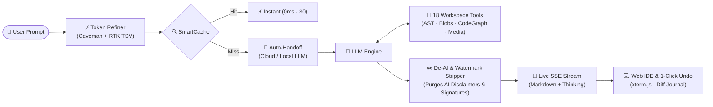
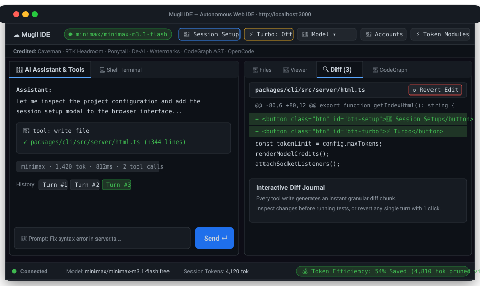

<div align="center">

# ☁️ Mugil IDE

### The Token-Efficient, Autonomous AI Coding Agent Harness & Web IDE

[](https://github.com/auarunkumar1/mugil-ide/releases)
[](LICENSE)
[](https://github.com/auarunkumar1/mugil-ide/releases)
[](https://github.com/auarunkumar1/mugil-ide)
[](https://github.com/auarunkumar1/mugil-ide)
[](https://github.com/auarunkumar1/mugil-ide)
[](README.md)

</div>

> [!IMPORTANT]
> **Direct Standalone Installers & Binary Releases on GitHub (npm Sunset Notice)**
>
> Official distribution of Mugil IDE has migrated directly to **[GitHub Releases](https://github.com/auarunkumar1/mugil-ide/releases)**. Publishing to `npmjs.com` has been **sunset** starting with this release.
>
> You no longer need `npm`, `node`, or any package manager installed to run Mugil IDE. Download official, self-contained click-to-run binaries and installers for your operating system:
>
> | Platform | Download & Package Type | How to Run |
> | :--- | :--- | :--- |
> | **Windows (x64)** | `mugil-ide-windows-x64.exe` | Double-click or run `.\mugil-ide-windows-x64.exe` |
> | **Linux (Ubuntu / Debian / Mint)** | `mugil-ide-linux-amd64.deb` | Double-click to install or `sudo dpkg -i mugil-ide-linux-amd64.deb` |
> | **Linux Universal (x64 / arm64)** | `mugil-ide-linux-x64.tar.gz` | Extract and run `./mugil-ide-linux-x64` |
> | **macOS (Apple Silicon M1/M2/M3/M4)** | `mugil-ide-darwin-arm64.tar.gz` | Extract and run `./mugil-ide-darwin-arm64` |
> | **macOS (Intel x64)** | `mugil-ide-darwin-x64.tar.gz` | Extract and run `./mugil-ide-darwin-x64` |
>
> 👉 **[Download the Latest Standalone Release on GitHub ↗](https://github.com/auarunkumar1/mugil-ide/releases)**

---

<div align="center">

**Welcome to Mugil IDE!** An open-source, ultra-efficient autonomous coding agent harness and developer environment that runs directly in your browser. Mugil IDE wraps state-of-the-art LLMs in a full-featured harness that reads, edits, tests, and debugs your software — while actively cutting 40% to 70% off your token consumption and API bills.

Works seamlessly with **free local models** (Ollama, LM Studio) and **state-of-the-art cloud intelligence** (OpenRouter, Anthropic Claude 3.7 Sonnet, OpenAI, DeepSeek, and Vercel AI).

<p align="center">
  <a href="#-quick-start"><b>⚡ Quick Start</b></a> •
  <a href="#-why-mugil-ide"><b>Why Mugil IDE</b></a> •
  <a href="#-visual-tour--ui-highlights"><b>Visual Tour</b></a> •
  <a href="#-feature-highlights"><b>Features</b></a> •
  <a href="#-18-autonomous-workspace-tools--subagent-swarms"><b>Tools Matrix</b></a> •
  <a href="#-whats-shipped-today-vs-next-release"><b>Shipped vs Roadmap</b></a> •
  <a href="#-downloads--installation"><b>Downloads</b></a> •
  <a href="#%EF%B8%8F-configuration--environment-variables"><b>Configuration</b></a>
</p>

</div>

---

## ⚡ Quick Start

Get up and running in under 60 seconds:

### Option 1: Standalone Binary (Zero dependencies, no Node/npm needed)
Download the standalone executable for your OS from **[GitHub Releases](https://github.com/auarunkumar1/mugil-ide/releases)**:
```bash
# Linux
chmod +x mugil-ide-linux-x64 && ./mugil-ide-linux-x64

# macOS
chmod +x mugil-ide-darwin-arm64 && ./mugil-ide-darwin-arm64

# Windows (PowerShell)
.\mugil-ide-windows-x64.exe
```

### Option 2: Running from Source
```bash
git clone https://github.com/auarunkumar1/mugil-ide.git
cd mugil-ide
npm install
npm start
```

### Option 3: 100% Free & Local AI (No API keys or cloud accounts needed)
Mugil IDE includes 1-click auto-connect for local models. If you have [Ollama](https://ollama.com) installed:
```bash
ollama run qwen2.5-coder:7b
# Launch Mugil IDE — it automatically detects Ollama at localhost:11434 with zero configuration!
```

---

## 🌟 Why Mugil IDE?

Most AI coding assistants treat tokens like water — stuffing thousands of lines of raw terminal logs, boilerplate comments, and conversational filler into your prompt until you hit a wall, run up a giant bill, or get hit with:

> `⚠ Answer was cut off by token limit`

**Mugil IDE is built differently.** It acts as an intelligent, token-compressing buffer between you and the LLM. It refines your input, strips AI signatures and watermarks, caches repetitive queries, extracts compact AST code skeletons, bounds generation limits dynamically, and gives you instant 1-click rollbacks if something goes wrong.

Best of all, **it's 100% browser-based with zero telemetry**. Launch it from your terminal, and it immediately opens a polished, two-pane dark-mode IDE in your browser with fully vendored assets — running fast, cleanly, and completely offline-capable.

### 🛡️ What is an Autonomous Agent Harness?

In AI-assisted software engineering, raw LLMs cannot write or maintain production code in isolation. An **Agent Harness** provides the robust execution substrate, tooling environment, and safety boundaries that enable an AI model to safely interact with a real repository:

- **Execution & Tool Loop:** Provides a sandboxed execution runtime for shell commands (`run_command`), surgical file edits (`edit_file`, `apply_patch`), CodeGraph AST symbol mapping, blob pagination (`read_blob`), and multi-provider asset generation (`generate_image`).
- **Token Economy & Context Engineering:** Optimizes token budgets before input hits the LLM (via Caveman linguistic compression and RTK deduplication) and extracts lightweight AST skeletons (`read_skeleton`) to save 70–80% of context tokens during codebase research.
- **Verification & Safe Rollbacks:** Pre-write snapshotting and an immutable session journal enable instant 1-click `/undo` rollbacks for both text and binary assets.
- **Interactive Developer Control:** Bridges the loop to a browser UI with token-by-token xterm.js streaming, live split-pane diff viewing, and Model Context Protocol (MCP) tooling.

---

## ✨ Feature Highlights

Every major capability in Mugil IDE is built to give you maximum developer superpowers while keeping token costs tiny. Here is how each feature works — defined simply first, and then under the hood.



---

### 1. ⚡ Token Refinement & Compression Pipeline

- **💡 Def:**  
  When you talk to an AI, roughly half of what gets sent is conversational fluff, redundant punctuation, repeating log lines, or obvious syntax. Mugil IDE automatically cleans your prompt before the AI reads it — dropping your bill by 40–70% without the model losing any context or meaning. When the AI responds, Mugil IDE purges AI disclaimers, watermarks, and conversational signatures before code hits your disk.
- **⚙️ Under the Hood:**  
  A multi-stage pipeline executes synchronously before handoff and after code generation:
  - **Caveman Strategy (Inbound):** Strips conversational pleasantries and filler tokens according to ASD-STE100 technical grammar rules.
  - **RTK (Reduced Token Kernel - Inbound):** Deduplicates repeated error messages, strips ANSI escape sequences, collapses matching test lines, and filters noisy build output.
  - **Ponytail Minimization (Inbound/Prompting):** Enforces standard library reuse and concise, surgical diffs, stopping the model from writing unnecessary boilerplate.
  - **De-AI Watermark & Signature Stripper (Post-Generation):** Intercepts generated code and responses to remove AI attribution watermarks, conversational sign-offs, and disclaimer headers before saving to disk or rendering in the UI.

---

### 2. 🚀 Pre-Session Setup & Live Token Economics

- **💡 Def:**  
  No more surprise bills! When you start a coding session, a friendly popup lets you choose your model, pick your history size, and see **exact pricing in real-time** (e.g., *$0.55/1M input* for DeepSeek-R1, or *Free / $0.00* for local Ollama). It even calculates the estimated worst-case cost of a full turn before you type a single word.
- **⚙️ Under the Hood:**  
  On launch, `/api/config` and `/api/models` probe configured local daemons (Ollama `:11434`, LM Studio `:1234`) and cloud catalogs (OpenRouter, Anthropic, OpenAI). The UI dynamically calculates:
  $$\text{Turn Cost} = \frac{(\text{History Budget} \times \text{Cost}_{\text{in}}) + (\text{Max Output} \times \text{Cost}_{\text{out}})}{1{,}000{,}000}$$
  All adjustments save directly to your session configuration without needing a server restart.

---

### 3. ⚡ Turbo Mode & Safety Permission Gates

- **💡 Def:**  
  Want to sit back and let the AI build an entire feature without nagging you for permission on every single file? Turn on **Turbo Mode**! Prefer to inspect every change before it hits your disk? Stay in standard **Act Mode** to get a preview modal, or **Plan Mode** for 100% read-only brainstorming.
- **⚙️ Under the Hood:**  
  The engine enforces an explicit `PermissionCheck` policy on all tool executions:
  - **Turbo Mode (`⚡ Turbo: ON`):** Bypasses confirmation prompts, automatically executing file edits, git patches, and shell commands. A prominent amber banner reminds you that autonomous execution is live.
  - **Act Mode (`⚡ Act`):** Intercepts dangerous actions (`write_file`, `edit_file`, `run_command`, MCP tools) and renders a modal in your browser showing the exact arguments with **Allow** / **Deny** buttons.
  - **Plan Mode (`🔒 Plan`):** Read-only mode. Workspace modifications and bash commands are denied outright, guaranteeing zero unwanted changes.

---

### 4. ⚙️ User-Definable History & Output Budgets (No More Cutoffs!)

- **💡 Def:**  
  Ever had an AI write 90% of a complex script only to stop in the middle of a loop because it ran out of output tokens? In Mugil IDE, you have dedicated knobs for both **History Budget** (how much past context to remember) and **Max Output Tokens** (how long an answer can be). Expanding your history will never accidentally squeeze your output generation budget!
- **⚙️ Under the Hood:**  
  Previous agent architectures floored completion tokens when conversation history grew large. Mugil IDE separates input history budgeting (`DEFAULT_HISTORY_BUDGET = 64,000`, override via `MUGIL_IDE_TOKEN_LIMIT`) from output generation (`DEFAULT_MAX_OUTPUT_TOKENS = 32,768`, override via `MUGIL_IDE_MAX_OUTPUT_TOKENS`). The pipeline computes:
  $$\text{contextRoom} = \text{contextWindow} - \text{promptTokens} - 1024$$
  and safely clamps generation headroom so the model always has space to complete its work.

---

### 5. 💾 Multi-Tier Smart Caching & Ephemeral Breakpoints

- **💡 Def:**  
  If you ask a similar question or run repeated tasks, Mugil IDE serves the answer instantly from cache instead of charging your credit card again.
- **⚙️ Under the Hood:**  
  Three progressive cache layers:
  - **Exact Match:** Instant hit on identical prompt digests.
  - **Partial Prefix Match ($O(L)$ `PrefixTrie`):** Reuses the common prefix of an answer when you append new instructions, generating only the delta.
  - **Semantic Match:** Matches prompts by cosine similarity of embeddings (via local Lexical or OpenAI embeddings).
  - **Provider-Level Prompt Caching:** Automatically injects Anthropic ephemeral breakpoints (`cache_control: { type: 'ephemeral' }`) and OpenAI key-sorted canonical JSON for automatic 90% provider input discounts.

---

### 6. 🛠️ 19 Autonomous Workspace Tools & Subagent Swarms

- **💡 Def:**  
  Mugil IDE comes out of the box with tools to search, read, write, test, explore, generate visual media, and refactor code. It can even spin up helper "subagents" to perform broad background research without cluttering your main conversation!
- **⚙️ Under the Hood:**  
  Built-in tools are organized into five specialized operational categories:

  | Category | Tools | Primary Capabilities |
  | :--- | :--- | :--- |
  | **Inspection & AST** | `read_file`, `read_symbol`, `read_skeleton`, `search_code`, `list_files`, `codegraph`, `read_blob` | AST code signatures, surgical single-function/class reader, regex pattern search, multi-language symbol graphs, and LRU blob chunking. |
  | **Surgical Editing** | `edit_file`, `apply_patch`, `write_file` | Precise 1-line unified diff replacements, multi-hunk patch application, atomic writes. |
  | **Shell & Execution** | `run_command` | Sandboxed command execution with process group timeouts, Delta Mode diffing, and RTK build noise filtering. |
  | **Swarm Orchestration**| `task` | Spawns scoped subagents (`explore` or `general`) executing on isolated Git worktrees. |
  | **Media & External** | `generate_image`, `webfetch`, `mcp` | Multi-tier visual asset generation, live URL retrieval, and Lazy Model Context Protocol gateway. |

---

### 7. 🔍 Live Diff Viewer & 1-Click Undo

- **💡 Def:**  
  Every change made by the AI appears in real-time in a split diff viewer. If the agent makes a mistake, click **"↩ Undo Edit"** or type `/undo` to instantly roll back your files to their exact previous state.
- **⚙️ Under the Hood:**  
  All file writes are tracked in an immutable session journal (`pushEdit`, `undoLast`). Diffs are computed on a background worker thread (`diffWorker.js`) so large multi-thousand line patches never freeze the browser terminal.

---

## 📸 Visual Tour & UI Highlights

<p align="center">
  
</p>

| Area | Features & Capabilities |
| :--- | :--- |
| **Top Navigation** | 🚀 **Pre-Session Setup Popup** · ⚡ **Turbo Mode Toggle** · 🤖 **Model Selector** · 🔑 **API Key Manager** · ⚡ **Token Budget Config** |
| **Attribution Strip** | Single-line compact strip giving direct credit to upstream projects: *Caveman, RTK Headroom, Ponytail, De-AI, Watermarks, CodeGraph AST, OpenCode* |
| **Left Pane (Agent Loop)** | Live xterm.js terminal with token-by-token streaming, markdown formatting, turn history pills, and isolated shell terminal with PTY support |
| **Right Pane (Code & Inspection)** | Interactive file tree, live diff viewer with syntax highlights, file viewer, and structural symbol CodeGraph |
| **Bottom Status Bar** | Live WebSocket connection indicator, active model ID, session token tally, and real input-token savings (`saved / compressible input` across Caveman, RTK, history compaction and cache hits) |

---

## 🚀 What's Shipped Today vs. Next Release

We believe in complete transparency. Here is a clear breakdown of what is fully built, tested, and working right now in **v0.2.0**, versus what is on the roadmap for **v0.3.0**:

### ✅ Shipped & Ready in v0.2.0 (Current Release)

#### 🧠 Token Economy & Context Architecture
- [x] **Delta Mode Diagnostics (RTK Error Cache):** Session error signature cache for recurring test/build commands (`npm test`, `pytest`, `cargo test`, `tsc`). Isolates resolved, new, and unchanged failures, collapsing repetitive stack traces into a single concise count line (`[Delta Mode: X unchanged failure(s) collapsed]`), saving 70%–85% of tokens during debug loops.
- [x] **Auto-Tiered File Reader & Surgical `read_symbol` Tool:** Automatically skeletonizes files >300 lines with line-number anchors to avoid exploratory token dumps; provides `read_symbol(path, symbol)` for precise AST/indentation-based extraction of specific functions, classes, interfaces, or types.
- [x] **Lazy MCP Schema Pruning:** Eliminates 2,000–5,000 static tokens of schema overhead on every turn via deferred discovery (`list_mcp_tools`, `call_mcp`).
- [x] **Local Offline ONNX Vector Semantic Cache:** 100% offline, cross-platform neural vector embeddings (384 dimensions) running in ~5–8ms on AMD, Intel, and Apple Silicon CPUs for zero-cost, offline semantic cache matching.
- [x] **Token Compression Suite:** Integrated Caveman prompt compression, RTK noise filters, Ponytail output minimization, and signature/watermark removers.
- [x] **AST Skeleton Code Reading:** `read_skeleton` tool extracts code signatures and types without bloated function bodies, saving 70–80% of exploratory tokens.
- [x] **Content-Compressed Retrieval (CCR):** LRU `BlobStore` for oversized tool outputs (>48k chars) with on-demand `read_blob` chunking.
- [x] **Smart Caching & Prefix Breakpoints:** Exact match, $O(L)$ `PrefixTrie` partial matching, and Anthropic ephemeral cache headers.
- [x] **Honest Savings Indicator:** Reports real input-token savings against compressible input (Caveman/RTK, signature stripping, history compaction, cache hits).
- [x] **Token Savings Breakdown Popover:** Granular 4-tier savings breakdown modal accessible by clicking the ribbon's Savings metric pill.
- [x] **Dynamic Context & Output Token Sizing:** Eliminates mid-sentence token cutoff errors via `MUGIL_IDE_MAX_OUTPUT_TOKENS` and dynamic context room calculation.
- [x] **Workload Presets & Interactive Sliders:** Presets (Light Convo, Deep Development, Big Codebase & Audit) with dual slider/number controls and real-time turn cost calculations.

#### 🛠️ Autonomous Tools & Execution Control
- [x] **Interactive Step Debugger:** Visual step-through interface to pause, inspect, edit tool call arguments, skip, or abort subagent operations before execution via the Web UI modal and WebSocket breakpoint protocol.
- [x] **Multi-File Split Diff Review & Hunk-by-Hunk Staging:** Side-by-side git staging and surgical hunk-by-hunk acceptance or reversion directly in the web UI via `POST /api/diff/hunk-apply`.
- [x] **Multi-Agent Worktree Squad Orchestration:** Concurrent subagent squads collaborating on isolated Git worktrees (`.mugil/worktrees/subagent-<id>`) to eliminate file collision race conditions.
- [x] **19 Autonomous Workspace Tools:** Full suite for reading, searching, symbols, editing, patching, running commands, media generation, and web exploration.
- [x] **Autonomous Image Generation & Truthful Asset Writing:** Built-in `generate_image` tool and Web UI modal with interactive Provider and Model selectors (Auto waterfall cascade or direct provider targeting with provider-specific model presets and custom model input). Dispatches across Vercel AI Gateway (`bfl/flux-2-klein-4b`), OpenRouter (`flux-3-image-klein`), OpenAI (`gpt-image-1` / DALL-E), Together AI, and keyless Pollinations AI. Honest extension matching (`sniffImageFormat`) forces extensions to match real magic bytes (PNG, JPEG, WebP, GIF, SVG), vector wrappers preserve genuine MIME types, and fallback vector placeholders are clearly flagged with diagnostic causes.
- [x] **Binary Diffing & Byte-Exact Undo:** `/api/diffs` flags binary files and skips raw patch calculations, displaying clean binary notifications in the diff viewer. The session journal captures binary states in base64 for byte-exact `/undo` restoration.
- [x] **Safe File Writing & Non-Code Diagnostics Filter:** `write_file` append mode and diagnostics bypass on documentation/logs/data files (`.md`, `.log`, `.txt`, `.json`), preventing infinite repair loops.
- [x] **Interactive Mid-Turn Limit Extension:** When the tool calling limit is reached, users can dynamically extend limits (+15/+30 iterations) or wrap up seamlessly mid-run.

#### 💻 Browser Web IDE & Developer Control
- [x] **Multi-Workspace Folder Management:** "Open Project Folder" and "Create New Project" modal and directory switcher without restarting the Node server (`/api/workspace/switch`, `/api/workspace/create`).
- [x] **Pluggable Extension & Skill Registry Drawer:** Visual UI modal to inspect, enable, and configure agent skills, custom tools, and external MCP servers.
- [x] **Modular Web UI Asset Extraction:** Built-in asset pipeline (`scripts/build-ui-assets.mjs`) extracting inline stylesheets and scripts into static bundles (`bundle.css`, `bundle.js`), hardening Content Security Policy.
- [x] **Browser-First Web IDE:** Dual-pane xterm.js interface with vendored assets (100% offline-ready).
- [x] **Turbo Mode Autonomous Execution:** Instant execution of writes, edits, and terminal commands without confirmation prompts, plus Act/Plan safety modes.
- [x] **One-Click Stop for Agent Streams:** A dedicated `■ Stop` button and `Esc` shortcut abort the in-flight turn without closing the session.
- [x] **Kill Server Button:** A red `⚠ Kill Server` header control opens a warning modal and stops the backend via the authorized `POST /api/shutdown` route, then shows a "Server stopped" screen instead of endlessly reconnecting.
- [x] **Visual Folder Browser & First-Run Project Creator:** Interactive file system navigator with OS shortcuts, folder picker, and instant `mkdir -p` project creation for quick onboarding.
- [x] **First-Run AI Setup & Zero-Key Onboarding:** Automatically detects fresh launches without configured API keys. Presents a streamlined welcome modal offering 1-click cloud provider configuration and free 100% offline local AI (Ollama `:11434`, LM Studio `:1234`).
- [x] **Live Session Spending & Improved Token Counter:** Real-time session spending tracker ($ USD) displayed continuously in the top navigation ribbon alongside token counts.
- [x] **Streamlined Ribbon UI & Collapsible Menu:** Clean top ribbon with zoom controls (`A−`, reset, `A+`) and live metrics; secondary controls consolidated into a collapsible `☰ Menu ▾`.
- [x] **Intelligent Modal Layering & Stack Management:** Proper z-index layering hierarchy ensuring API Key Manager and Welcome Dialogs render smoothly in front of setup and workspace modals.

#### 🌐 Multi-Provider Handoff & Protocols
- [x] **Unified OpenAI Wire Client Consolidation:** Consolidated repetitive OpenAI-compatible provider wire implementations into a single configurable client architecture (`UnifiedWireClient`).
- [x] **Multi-Provider Auto Handoff:** OpenRouter, Anthropic, OpenAI, Vercel AI, Cloudflare, Together AI, Ollama, LM Studio, and local endpoints.
- [x] **Working Vercel AI Gateway:** Targets `https://ai-gateway.vercel.sh/v1`, uses namespaced `creator/model` IDs, honours `AI_GATEWAY_API_KEY`, and imports real per-model pricing.
- [x] **Verified Provider API Paths:** Cloudflare workers AI Gateway now uses `gateway.ai.cloudflare.com/v1/{account}/{gateway}/openai/chat/completions` and its model catalog actually loads; OpenCode supports documented `https://opencode.ai/inference` base alongside legacy `zen/v1`.
- [x] **OpenRouter & Streaming Protocol Hardening:** Populated `stream_options = { include_usage: true }` on streaming LLM requests and implemented typed `OpenRouterError` handling.
- [x] **Model Context Protocol (MCP):** Consume external MCP servers as tools, or run Mugil IDE as an MCP server via `mugil-ide-mcp`.
- [x] **Online Web Access (`webfetch`) Toggle:** Configurable in pre-session setup and environment settings, enabling live web fetching when required.

#### 🛡️ Reliability, Security & Hardening
- [x] **Unified Workspace Path Containment:** Shared `resolveInsideWorkspace` helper in `@mugil-ide/core` prevents lexical directory traversal and symlink/junction escapes across tools and HTTP routes (`/api/generate-image`, `/api/file`).
- [x] **Crash-Audit Hardening (all nine findings from `crash-audit-26-10-26.md`):** global `unhandledRejection`/`uncaughtException` handlers, 400 (not `exit 1`) on malformed `Host`, socket-scoped WebSocket frame errors, non-throwing session autosave, fallback-PTY spawn-error surfacing, linear-time CodeGraph (20k symbols: 5.1 s → 83 ms), WebSocket flow control, `run_command` process-group kills, and a bounded `SmartCache` trie.
- [x] **Update-Available Indicator:** A `⬆ vX.Y.Z` pill appears beside the header version when npm has a newer release, backed by `GET /api/update-check` (6-hour cache, 4-second timeout, never blocks startup), linking straight to the release tag.
- [x] **Clean Session Token URL Routing:** Separated pristine base server URLs from authenticated browser launch tokens (`server.tokenUrl`), eliminating query parameter duplication.
- [x] **Deterministic CI & Test Suite Reliability:** Hard 15-minute execution timeouts and explicit server connection teardown hooks in the HTTP/WebSocket runtime, resolving keep-alive runner hangs on GitHub Actions.
- [x] **Standalone Compiled Executables & GitHub Releases:** Downloadable click-to-run binaries for Windows (`.exe`), Linux (`.deb` / `.tar.gz`), and macOS (`arm64` / `x64`) without requiring Node or npm.
- [x] **Comprehensive Test Suite:** 575 unit and integration tests passing across all packages (43 test suites: 503 core, 54 cli, 10 docs, 8 mcp).

### 🎯 Planned for Next Release Push (v0.3.0 Roadmap)

- [ ] **Native Desktop Shell Packaging:** Optional Tauri/Electron lightweight shell wrapper alongside browser Web UI.
- [ ] **Multi-Modal Audio & Voice Interaction:** Real-time voice input and speech streaming via local Whisper / Piper models.
- [ ] **Autonomous Git PR Automation:** Direct GitHub PR generation with multi-file diff explanations and automated test reports.

---

## 💻 Downloads & Installation

### Option 1: Standalone Compiled Executables (Recommended)
Download the standalone executable directly from **[GitHub Releases](https://github.com/auarunkumar1/mugil-ide/releases)**:
- **Windows:** Download `mugil-ide-windows-x64.exe` and launch it from PowerShell or double-click.
- **Linux (Debian/Ubuntu):** Install the `.deb` package:
  ```bash
  sudo dpkg -i mugil-ide-linux-amd64.deb
  mugil-ide
  ```
- **Linux / macOS Universal:** Extract the `.tar.gz` and run the binary:
  ```bash
  tar -xzvf mugil-ide-linux-x64.tar.gz
  ./mugil-ide-linux-x64
  ```

---

### Option 2: Running from Source (Development)
If you are developing or contributing to Mugil IDE:
- Requirements: **Node.js >= 20** or **Bun >= 1.2**

```bash
# Clone the repository
git clone https://github.com/auarunkumar1/mugil-ide.git
cd mugil-ide

# Install dependencies and build
npm install
npm run build

# Start the IDE
npm start
```

---

### Monorepo Architecture & Packages

Mugil IDE is organized as a modular TypeScript monorepo across four packages:

| Package | Purpose | Workspace Directory | Release Tarball |
| :--- | :--- | :--- | :--- |
| **`mugil-ide`** | The complete web IDE, local HTTP/WebSocket server, and CLI tools | `packages/cli` | `mugil-ide-0.1.26.tgz` |
| **`@mugil-ide/core`** | The core engine: token compression, smart cache, auto handoff, and tool loop | `packages/core` | `mugil-ide-core-0.1.26.tgz` |
| **`@mugil-ide/mcp`** | Model Context Protocol stdio server exposing the engine as tools | `packages/mcp` | `mugil-ide-mcp-0.1.26.tgz` |
| **`@mugil-ide/docs`** | Automated markdown documentation generator from source code | `packages/docs` | `mugil-ide-docs-0.1.26.tgz` |

> [!NOTE]
> **Installing Tarballs via npm:** While distribution via the public `npmjs.com` registry is sunset in favor of standalone releases, release tarballs (`.tgz`) are built via `npm run pack` and attached to each **[GitHub Release](https://github.com/auarunkumar1/mugil-ide/releases)**. To install globally using Node.js without compiling:
> ```bash
> npm install -g https://github.com/auarunkumar1/mugil-ide/releases/download/v0.1.26/mugil-ide-0.1.26.tgz
> ```

---

## 🛠️ CLI Utilities & Standalone Modes

In addition to the interactive Web IDE, Mugil IDE includes several handy CLI tools:

### One-Shot Headless Mode (`run`)
Run a quick prompt through the token-compression pipeline without opening the browser:

```bash
mugil-ide run "Write a binary search function in TypeScript"

# Run with a specific model and thinking level
mugil-ide run -m anthropic/claude-3.7-sonnet -t high "Optimize this SQL query"

# Output raw JSON with token savings breakdown
mugil-ide run --json "Refactor auth middleware"
```

### Automated Documentation Generator (`docs`)
Scan your codebase, extract function signatures and JSDoc comments, and generate clean markdown documentation:

```bash
mugil-ide docs . -o DOCUMENTATION.md
```

### Standalone MCP Server (`mugil-ide-mcp`)
Expose Mugil IDE's token-saving tools to Claude Desktop, Cursor, or any MCP client:

```bash
mugil-ide-mcp
```

---

## ⚙️ Configuration & Environment Variables

All settings can be configured via the Web UI modals or by editing `~/.config/mugil-ide/.env` (or setting environment variables):

| Variable | Default | Description |
| :--- | :--- | :--- |
| `MUGIL_IDE_TOKEN_LIMIT` | `64000` | Context token budget for multi-turn history window |
| `MUGIL_IDE_MAX_OUTPUT_TOKENS` | `32768` | Model generation ceiling (prevents output cutoff errors) |
| `MUGIL_IDE_TURBO_MODE` | `0` | Set to `1` to enable autonomous execution without user prompts |
| `MUGIL_IDE_HISTORY_BUDGET` | `64000` | Sliding window token budget for past conversation turns |
| `MUGIL_IDE_MAX_TURNS` | `100` | Maximum number of turns kept in active history before compacting |
| `MUGIL_IDE_MODE` | `act` | Default mode: `act` (prompts before changes) or `plan` (read-only) |
| `OPENROUTER_API_KEY` | — | API key for OpenRouter (primary cloud gateway) |
| `OPENAI_API_KEY` | — | API key for OpenAI |
| `ANTHROPIC_API_KEY` | — | API key for Anthropic |
| `VERCEL_API_KEY` | — | API key for the [Vercel AI Gateway](https://vercel.com/docs/ai-gateway) (`AI_GATEWAY_API_KEY` is accepted as an alias) |
| `VERCEL_BASE_URL` | `https://ai-gateway.vercel.sh/v1` | AI Gateway endpoint — model ids are namespaced, e.g. `anthropic/claude-sonnet-4.5` |
| `MUGIL_IDE_IMAGE_MODEL` | `bfl/flux-2-klein-4b` | Default image generation model for Vercel AI Gateway |
| `MUGIL_IDE_OPENAI_IMAGE_MODEL` | `gpt-image-1` | Model override for OpenAI image generation (e.g. `dall-e-3`) |
| `MUGIL_IDE_OPENROUTER_IMAGE_MODEL` | `black-forest-labs/flux-3-image-klein` | Model override for OpenRouter image generation |
| `MUGIL_IDE_TOGETHER_IMAGE_MODEL` | `black-forest-labs/FLUX.1-schnell` | Model override for Together AI image generation |
| `OLLAMA_BASE_URL` | `http://localhost:11434/v1` | URL for local Ollama instances |
| `LMSTUDIO_BASE_URL` | `http://localhost:1234/v1` | URL for local LM Studio instances |
| `MUGIL_IDE_COMMAND_TIMEOUT`| `60000` | Terminal command execution timeout in milliseconds |
| `MUGIL_IDE_MAX_TOOL_CHARS` | `48000` | Maximum character length for a tool return before CCR blob caching |

---

## 🧑‍💻 Contributing & Building from Source

We warmly welcome community contributions, issues, and pull requests! Before preparing or publishing a release, consult the [Pre-Release & CI Verification Guide](docs/PRE_RELEASE_CI_GUIDE.md).

```bash
# Clone the repository
git clone https://github.com/auarunkumar1/mugil-ide.git
cd mugil-ide

# Install dependencies and build all packages
npm install
npm run build

# Run the full test suite (575 tests across 43 suites)
npm test

# Launch local development server
node packages/cli/dist/index.js
```

---

## ❤️ Open-Source Attributions

Mugil IDE stands on the shoulders of brilliant open-source pioneers. We gratefully credit and celebrate the projects that inspired our modular engine:

- **[Caveman](https://github.com/JuliusBrussee/caveman)** by Julius Brussee — Filler-free, ultra-compressed prompt communication.
- **[RTK](https://github.com/rtk-ai/rtk)** by RTK AI — Reduced Token Kernel for command noise reduction and log compression.
- **[Ponytail](https://github.com/DietrichGebert/ponytail)** by Dietrich Gebert — Output minimization and "laziest senior developer" discipline.
- **[Avoid AI Writing](https://github.com/conorbronsdon/avoid-ai-writing)** by Conor Bronsdon — Signature and AI boilerplate stripping.
- **[Watermarks Remover](https://github.com/guillaumemeyer/watermarks-remover)** by Guillaume Meyer — AI provenance watermark stripping.
- **[CodeGraph](https://github.com/colbymchenry/codegraph)** by Colby McHenry — Knowledge graph indexing for codebases.
- **[OpenCode](https://github.com/sst/opencode)** by SST — Clean coding agent architectures and context trimming patterns.

See [ATTRIBUTIONS.md](ATTRIBUTIONS.md) for complete licenses and attribution notices.

---

<div align="center">

**Built with ❤️ for developers who love fast code, clean context, and smaller bills.**  
*Star us on GitHub if you find Mugil IDE helpful!*

</div>
