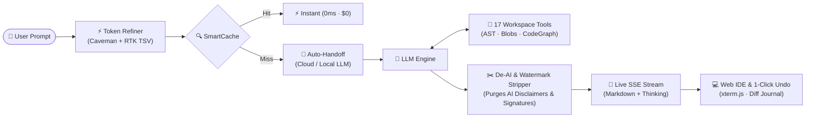
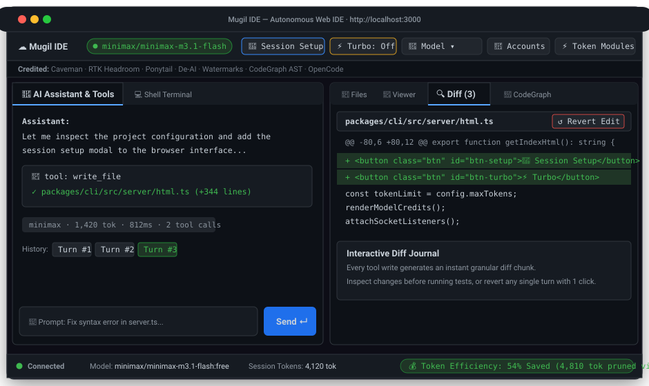

<div align="center">

# ☁️ Mugil IDE

### The Token-Efficient, Autonomous AI Coding IDE for the Web

[](https://github.com/auarunkumar1/mugil-ide/releases)
[](LICENSE)
[](https://github.com/auarunkumar1/mugil-ide/releases)
[](https://github.com)
[](README.md)

</div>

> [!IMPORTANT]
> **Direct Standalone Installers & Binary Releases on GitHub (npm Sunset Notice)**
>
> Official distribution of Mugil IDE has migrated directly to **[GitHub Releases](https://github.com/auarunkumar1/mugil-ide/releases)**. Publishing to `npmjs.com` has been **sunset** starting with this release.
>
> You no longer need `npm`, `node`, or any package manager installed to run Mugil IDE. Download official, self-contained click-to-run binaries and installers for your operating system:
>
> | Platform | Download & Package Type | How to Run |
> | :--- | :--- | :--- |
> | **Windows (x64)** | `mugil-ide-windows-x64.exe` | Double-click or run `.\mugil-ide-windows-x64.exe` |
> | **Linux (Ubuntu / Debian / Mint)** | `mugil-ide-linux-amd64.deb` | Double-click to install or `sudo dpkg -i mugil-ide-linux-amd64.deb` |
> | **Linux Universal (x64 / arm64)** | `mugil-ide-linux-x64.tar.gz` | Extract and run `./mugil-ide-linux-x64` |
> | **macOS (Apple Silicon M1/M2/M3/M4)** | `mugil-ide-darwin-arm64.tar.gz` | Extract and run `./mugil-ide-darwin-arm64` |
> | **macOS (Intel x64)** | `mugil-ide-darwin-x64.tar.gz` | Extract and run `./mugil-ide-darwin-x64` |
>
> 👉 **[Download the Latest Standalone Release on GitHub ↗](https://github.com/auarunkumar1/mugil-ide/releases)**

---

<div align="center">

**Welcome to Mugil IDE!** An open-source, ultra-efficient autonomous coding environment that runs directly in your browser. Mugil IDE gives you a full-featured agentic coding partner that reads, edits, tests, and debugs your software — while actively cutting 40% to 70% off your token consumption and API bills.

Works seamlessly with **free local models** (Ollama, LM Studio) and **state-of-the-art cloud intelligence** (OpenRouter, Anthropic Claude 3.7 Sonnet, OpenAI, DeepSeek, and Vercel AI).

[Downloads & Releases](#-downloads--installation) · [Feature Highlights](#-feature-highlights) · [Shipped vs Roadmap](#-whats-shipped-today-vs-next-release) · [Configuration](#-configuration--environment-variables) · [Attributions](#-open-source-attributions)

</div>

---

## 🌟 Why Mugil IDE?

Most AI coding assistants treat tokens like water — stuffing thousands of lines of raw terminal logs, boilerplate comments, and conversational filler into your prompt until you hit a wall, run up a giant bill, or get hit with:

> `⚠ Answer was cut off by token limit`

**Mugil IDE is built differently.** It acts as an intelligent, token-compressing buffer between you and the LLM. It refines your input, strips AI signatures and watermarks, caches repetitive queries, extracts compact AST code skeletons, bounds generation limits dynamically, and gives you instant 1-click rollbacks if something goes wrong.

Best of all, **it's 100% browser-based with zero telemetry**. Launch it from your terminal, and it immediately opens a polished, two-pane dark-mode IDE in your browser with fully vendored assets — running fast, cleanly, and completely offline-capable.

---

## ✨ Feature Highlights

Every major capability in Mugil IDE is built to give you maximum developer superpowers while keeping token costs tiny. Here is how each feature works — defined simply first, and then under the hood.



---

### 1. ⚡ Token Refinement & Compression Pipeline

- **💡 Def:**  
  When you talk to an AI, roughly half of what gets sent is conversational fluff, redundant punctuation, repeating log lines, or obvious syntax. Mugil IDE automatically cleans your prompt before the AI reads it — dropping your bill by 40–70% without the model losing any context or meaning. When the AI responds, Mugil IDE purges AI disclaimers, watermarks, and conversational signatures before code hits your disk.
- **⚙️ Under the Hood:**  
  A multi-stage pipeline executes synchronously before handoff and after code generation:
  - **Caveman Strategy (Inbound):** Strips conversational pleasantries and filler tokens according to ASD-STE100 technical grammar rules.
  - **RTK (Reduced Token Kernel - Inbound):** Deduplicates repeated error messages, strips ANSI escape sequences, collapses matching test lines, and filters noisy build output.
  - **Ponytail Minimization (Inbound/Prompting):** Enforces standard library reuse and concise, surgical diffs, stopping the model from writing unnecessary boilerplate.
  - **De-AI Watermark & Signature Stripper (Post-Generation):** Intercepts generated code and responses to remove AI attribution watermarks, conversational sign-offs, and disclaimer headers before saving to disk or rendering in the UI.

---

### 2. 🚀 Pre-Session Setup & Live Token Economics

- **💡 Def:**  
  No more surprise bills! When you start a coding session, a friendly popup lets you choose your model, pick your history size, and see **exact pricing in real-time** (e.g., *$0.55/1M input* for DeepSeek-R1, or *Free / $0.00* for local Ollama). It even calculates the estimated worst-case cost of a full turn before you type a single word.
- **⚙️ Under the Hood:**  
  On launch, `/api/config` and `/api/models` probe configured local daemons (Ollama `:11434`, LM Studio `:1234`) and cloud catalogs (OpenRouter, Anthropic, OpenAI). The UI dynamically calculates:
  $$\text{Turn Cost} = \frac{(\text{History Budget} \times \text{Cost}_{\text{in}}) + (\text{Max Output} \times \text{Cost}_{\text{out}})}{1{,}000{,}000}$$
  All adjustments save directly to your session configuration without needing a server restart.

---

### 3. ⚡ Turbo Mode & Safety Permission Gates

- **💡 Def:**  
  Want to sit back and let the AI build an entire feature without nagging you for permission on every single file? Turn on **Turbo Mode**! Prefer to inspect every change before it hits your disk? Stay in standard **Act Mode** to get a preview modal, or **Plan Mode** for 100% read-only brainstorming.
- **⚙️ Under the Hood:**  
  The engine enforces an explicit `PermissionCheck` policy on all tool executions:
  - **Turbo Mode (`⚡ Turbo: ON`):** Bypasses confirmation prompts, automatically executing file edits, git patches, and shell commands. A prominent amber banner reminds you that autonomous execution is live.
  - **Act Mode (`⚡ Act`):** Intercepts dangerous actions (`write_file`, `edit_file`, `run_command`, MCP tools) and renders a modal in your browser showing the exact arguments with **Allow** / **Deny** buttons.
  - **Plan Mode (`🔒 Plan`):** Read-only mode. Workspace modifications and bash commands are denied outright, guaranteeing zero unwanted changes.

---

### 4. ⚙️ User-Definable History & Output Budgets (No More Cutoffs!)

- **💡 Def:**  
  Ever had an AI write 90% of a complex script only to stop in the middle of a loop because it ran out of output tokens? In Mugil IDE, you have dedicated knobs for both **History Budget** (how much past context to remember) and **Max Output Tokens** (how long an answer can be). Expanding your history will never accidentally squeeze your output generation budget!
- **⚙️ Under the Hood:**  
  Previous agent architectures floored completion tokens when conversation history grew large. Mugil IDE separates input history budgeting (`DEFAULT_HISTORY_BUDGET = 16,000`, override via `MUGIL_IDE_TOKEN_LIMIT`) from output generation (`DEFAULT_MAX_OUTPUT_TOKENS = 8,192`, override via `MUGIL_IDE_MAX_OUTPUT_TOKENS`). The pipeline computes:
  $$\text{contextRoom} = \text{contextWindow} - \text{promptTokens} - 1024$$
  and safely clamps generation headroom so the model always has space to complete its work.

---

### 5. 💾 Multi-Tier Smart Caching & Ephemeral Breakpoints

- **💡 Def:**  
  If you ask a similar question or run repeated tasks, Mugil IDE serves the answer instantly from cache instead of charging your credit card again.
- **⚙️ Under the Hood:**  
  Three progressive cache layers:
  - **Exact Match:** Instant hit on identical prompt digests.
  - **Partial Prefix Match ($O(L)$ `PrefixTrie`):** Reuses the common prefix of an answer when you append new instructions, generating only the delta.
  - **Semantic Match:** Matches prompts by cosine similarity of embeddings (via local Lexical or OpenAI embeddings).
  - **Provider-Level Prompt Caching:** Automatically injects Anthropic ephemeral breakpoints (`cache_control: { type: 'ephemeral' }`) and OpenAI key-sorted canonical JSON for automatic 90% provider input discounts.

---

### 6. 🛠️ 17 Autonomous Workspace Tools & Subagent Swarms

- **💡 Def:**  
  Mugil IDE comes out of the box with tools to search, read, write, test, explore, and refactor code. It can even spin up helper "subagents" to perform broad background research without cluttering your main conversation!
- **⚙️ Under the Hood:**  
  Built-in tools include:
  - `read_file` & `read_skeleton`: AST-aware code reader that extracts types, signatures, and interfaces while omitting internal function bodies — saving 70–80% of tokens during exploratory research.
  - `edit_file` & `apply_patch`: Surgical diff replacements with unified 1-line context reduction.
  - `run_command`: Sandboxed shell execution with execution buffers and noise filters.
  - `codegraph`: Full AST symbol and dependency graph (functions, classes, imports) mapped across TypeScript, JavaScript, Python, Go, and Rust.
  - `read_blob` (Content-Compressed Retrieval): Oversized tool returns (>48k chars) are automatically saved to an LRU `BlobStore`, returning a lightweight pointer `[Blob #id]` so the AI can page specific slices without inflating prompt history.
  - `task`: Spawns scoped subagents (`explore` or `general`) that run independent tool loops and report distilled summaries back to the parent.

---

### 7. 🔍 Live Diff Viewer & 1-Click Undo

- **💡 Def:**  
  Every change made by the AI appears in real-time in a split diff viewer. If the agent makes a mistake, click **"↩ Undo Edit"** or type `/undo` to instantly roll back your files to their exact previous state.
- **⚙️ Under the Hood:**  
  All file writes are tracked in an immutable session journal (`pushEdit`, `undoLast`). Diffs are computed on a background worker thread (`diffWorker.js`) so large multi-thousand line patches never freeze the browser terminal.

---

## 📸 Visual Tour & UI Highlights

<p align="center">
  
</p>

| Area | Features & Capabilities |
| :--- | :--- |
| **Top Navigation** | 🚀 **Pre-Session Setup Popup** · ⚡ **Turbo Mode Toggle** · 🤖 **Model Selector** · 🔑 **API Key Manager** · ⚡ **Token Budget Config** |
| **Attribution Strip** | Single-line compact strip giving direct credit to upstream projects: *Caveman, RTK Headroom, Ponytail, De-AI, Watermarks, CodeGraph AST, OpenCode* |
| **Left Pane (Agent Loop)** | Live xterm.js terminal with token-by-token streaming, markdown formatting, turn history pills, and isolated shell terminal with PTY support |
| **Right Pane (Code & Inspection)** | Interactive file tree, live diff viewer with syntax highlights, file viewer, and structural symbol CodeGraph |
| **Bottom Status Bar** | Live WebSocket connection indicator, active model ID, session token tally, and calculated token savings percentage |

---

## 🚀 What's Shipped Today vs. Next Release

We believe in complete transparency. Here is a clear breakdown of what is fully built, tested, and working right now in **v0.1.23**, versus what is on the roadmap for **v0.2.0**:

### ✅ Shipped & Ready in v0.1.23 (Current Release)
- [x] **One-Click Stop for Agent Streams:** A dedicated `■ Stop` button and `Esc` shortcut abort the in-flight turn — streaming completion, tool loop, or running subagent — without closing the session. Pending permission/question prompts are dismissed instantly and any partial answer is marked "incomplete, not saved".
- [x] **Working Vercel AI Gateway:** The Vercel provider now targets `https://ai-gateway.vercel.sh/v1` (the previously configured host did not resolve), uses the gateway's namespaced `creator/model` ids, honours `AI_GATEWAY_API_KEY`, and imports real per-model pricing and context windows from the live catalog.

- [x] **First-Run AI Setup & Zero-Key Onboarding:** Automatically detects fresh launches without configured API keys. Presents a streamlined welcome modal offering 1-click cloud provider configuration (OpenRouter, OpenAI, Anthropic, OpenCode) and free 100% offline local AI (Ollama `:11434`, LM Studio `:1234`).
- [x] **Intelligent Modal Layering & Stack Management:** Proper z-index layering hierarchy ensuring API Key Manager and Welcome Dialogs render smoothly in front of setup and workspace modals.
- [x] **Deterministic CI & Test Suite Reliability:** Hard 15-minute execution timeouts and explicit server connection teardown hooks (`closeAllConnections`, `closeIdleConnections`) in the HTTP/WebSocket runtime, resolving keep-alive runner hangs on Node 20 & 22 GitHub Actions.
- [x] **OpenRouter & Streaming Protocol Hardening:** Populated `stream_options = { include_usage: true }` on streaming LLM requests and implemented typed `OpenRouterError` handling for robust error reporting during streaming disconnects.
- [x] **Clean Session Token URL Routing:** Separated pristine base server URLs from authenticated browser launch tokens (`server.tokenUrl`), eliminating query parameter duplication and CLI link corruption.
- [x] **Standalone Compiled Executables & GitHub Releases:** Downloadable click-to-run binaries for Windows (`.exe`), Linux (`.deb` / `.tar.gz`), and macOS (`arm64` / `x64`) without requiring Node or npm.
- [x] **Visual Folder Browser & First-Run Project Creator:** Interactive file system navigator with OS shortcuts, folder picker, and instant `mkdir -p` project creation for quick onboarding.
- [x] **Browser-First Web IDE:** Dual-pane xterm.js interface with vendored assets (100% offline-ready).
- [x] **Workload Presets & Interactive Sliders:** Presets (Light Convo, Deep Development, Big Codebase & Audit) with dual slider/number controls and real-time turn cost calculations.
- [x] **Interactive Mid-Turn Limit Extension:** When the tool calling limit is reached, users can dynamically extend limits (+15/+30 iterations) or wrap up seamlessly mid-run.
- [x] **Live Session Spending & Improved Token Counter:** Real-time session spending tracker ($ USD) displayed continuously in the top navigation ribbon alongside token counts.
- [x] **Streamlined Ribbon UI & Collapsible Menu:** Clean top ribbon with zoom controls (`A−`, reset, `A+`) and live metrics; secondary controls consolidated into a collapsible `☰ Menu ▾`.
- [x] **Online Web Access (`webfetch`) Toggle:** Configurable in pre-session setup and environment settings, enabling live web fetching when required.
- [x] **Safe File Writing & Non-Code Diagnostics Filter:** `write_file` append mode and diagnostics bypass on documentation/logs/data files (`.md`, `.log`, `.txt`, `.json`), preventing infinite repair loops.
- [x] **Turbo Mode Autonomous Execution:** Instant execution of writes, edits, and terminal commands without confirmation prompts, plus Act/Plan safety modes.
- [x] **Dynamic Context & Output Token Sizing:** Eliminates mid-sentence token cutoff errors via `MUGIL_IDE_MAX_OUTPUT_TOKENS` and dynamic context room calculation.
- [x] **Token Compression Suite:** Integrated Caveman prompt compression, RTK noise filters, Ponytail output minimization, and signature/watermark removers.
- [x] **Content-Compressed Retrieval (CCR):** LRU `BlobStore` for oversized tool outputs with on-demand `read_blob` chunking.
- [x] **AST Skeleton Code Reading:** `read_skeleton` tool extracts code signatures and types without bloated function bodies.
- [x] **Smart Caching & Prefix Breakpoints:** Exact match, $O(L)$ `PrefixTrie` partial matching, and Anthropic ephemeral cache headers.
- [x] **17 Autonomous Workspace Tools:** Full suite for reading, searching, editing, patching, running commands, and web exploration.
- [x] **Multi-Provider Auto Handoff:** OpenRouter, Anthropic, OpenAI, Vercel AI, Cloudflare, Together AI, Ollama, LM Studio, and local endpoints.
- [x] **Model Context Protocol (MCP):** Consume external MCP servers as tools, or run Mugil IDE as an MCP server via `mugil-ide-mcp`.
- [x] **Comprehensive Test Suite:** 481 unit and integration tests passing across all packages.

### 🎯 Planned for Next Release Push (v0.2.0 Roadmap)

- [ ] **Interactive Step Debugger:** Visual step-through interface to pause, inspect, and rewind subagent tool executions.
- [ ] **Multi-File Split Diff Review:** Side-by-side git staging and hunk-by-hunk acceptance directly in the web UI.
- [ ] **Local Vector Semantic Cache:** Embedded lightweight ONNX embedding engine for 100% offline semantic cache matches without external API keys.
- [ ] **Pluggable Extension Registry:** One-click installation of community-contributed tools and custom skills packaged via npm.
- [ ] **Multi-Agent Squad Orchestration:** Concurrent subagent squads collaborating on independent workspace git worktrees.

---

## 💻 Downloads & Installation

### Option 1: Standalone Compiled Executables (Recommended)
Download the standalone executable directly from **[GitHub Releases](https://github.com/auarunkumar1/mugil-ide/releases)**:
- **Windows:** Download `mugil-ide-windows-x64.exe` and launch it from PowerShell or double-click.
- **Linux (Debian/Ubuntu):** Install the `.deb` package:
  ```bash
  sudo dpkg -i mugil-ide-linux-amd64.deb
  mugil-ide
  ```
- **Linux / macOS Universal:** Extract the `.tar.gz` and run the binary:
  ```bash
  tar -xzvf mugil-ide-linux-x64.tar.gz
  ./mugil-ide-linux-x64
  ```

---

### Option 2: Running from Source (Development)
If you are developing or contributing to Mugil IDE:
- Requirements: **Node.js >= 20** or **Bun >= 1.2**

```bash
# Clone the repository
git clone https://github.com/auarunkumar1/mugil-ide.git
cd mugil-ide

# Install dependencies and build
npm install
npm run build

# Start the IDE
npm start
```

---

### Monorepo Packages

Mugil IDE is organized as an open-source monorepo published to npm:

| Package | Purpose | Installation |
| :--- | :--- | :--- |
| **`mugil-ide`** | The complete web IDE, local HTTP/WebSocket server, and CLI tools | `npm i -g mugil-ide` |
| **`@mugil-ide/core`** | The core engine: token compression, smart cache, auto handoff, and tool loop | `npm i @mugil-ide/core` |
| **`@mugil-ide/mcp`** | Model Context Protocol stdio server exposing the engine as tools | `npm i -g @mugil-ide/mcp` |
| **`@mugil-ide/docs`** | Automated markdown documentation generator from source code | `npm i @mugil-ide/docs` |

---

## 🛠️ CLI Utilities & Standalone Modes

In addition to the interactive Web IDE, Mugil IDE includes several handy CLI tools:

### One-Shot Headless Mode (`run`)
Run a quick prompt through the token-compression pipeline without opening the browser:

```bash
mugil-ide run "Write a binary search function in TypeScript"

# Run with a specific model and thinking level
mugil-ide run -m anthropic/claude-3.7-sonnet -t high "Optimize this SQL query"

# Output raw JSON with token savings breakdown
mugil-ide run --json "Refactor auth middleware"
```

### Automated Documentation Generator (`docs`)
Scan your codebase, extract function signatures and JSDoc comments, and generate clean markdown documentation:

```bash
mugil-ide docs . -o DOCUMENTATION.md
```

### Standalone MCP Server (`mugil-ide-mcp`)
Expose Mugil IDE's token-saving tools to Claude Desktop, Cursor, or any MCP client:

```bash
mugil-ide-mcp
```

---

## ⚙️ Configuration & Environment Variables

All settings can be configured via the Web UI modals or by editing `~/.config/mugil-ide/.env` (or setting environment variables):

| Variable | Default | Description |
| :--- | :--- | :--- |
| `MUGIL_IDE_TOKEN_LIMIT` | `32000` | Context token budget for multi-turn history window |
| `MUGIL_IDE_MAX_OUTPUT_TOKENS` | `8192` | Model generation ceiling (prevents output cutoff errors) |
| `MUGIL_IDE_TURBO_MODE` | `0` | Set to `1` to enable autonomous execution without user prompts |
| `MUGIL_IDE_HISTORY_BUDGET` | `16000` | Sliding window token budget for past conversation turns |
| `MUGIL_IDE_MAX_TURNS` | `50` | Maximum number of turns kept in active history before compacting |
| `MUGIL_IDE_MODE` | `act` | Default mode: `act` (prompts before changes) or `plan` (read-only) |
| `OPENROUTER_API_KEY` | — | API key for OpenRouter (primary cloud gateway) |
| `OPENAI_API_KEY` | — | API key for OpenAI |
| `ANTHROPIC_API_KEY` | — | API key for Anthropic |
| `VERCEL_API_KEY` | — | API key for the [Vercel AI Gateway](https://vercel.com/docs/ai-gateway) (`AI_GATEWAY_API_KEY` is accepted as an alias) |
| `VERCEL_BASE_URL` | `https://ai-gateway.vercel.sh/v1` | AI Gateway endpoint — model ids are namespaced, e.g. `anthropic/claude-sonnet-4.5` |
| `OLLAMA_BASE_URL` | `http://localhost:11434/v1` | URL for local Ollama instances |
| `LMSTUDIO_BASE_URL` | `http://localhost:1234/v1` | URL for local LM Studio instances |
| `MUGIL_IDE_COMMAND_TIMEOUT`| `60000` | Terminal command execution timeout in milliseconds |
| `MUGIL_IDE_MAX_TOOL_CHARS` | `48000` | Maximum character length for a tool return before CCR blob caching |

---

## 🧑‍💻 Contributing & Building from Source

We warmly welcome community contributions, issues, and pull requests! Before preparing or publishing a release, consult the [Pre-Release & CI Verification Guide](docs/PRE_RELEASE_CI_GUIDE.md).

```bash
# Clone the repository
git clone https://github.com/your-username/IDE.git
cd IDE

# Install dependencies and build all packages
npm install
npm run build

# Run the full test suite (481 tests)
npm test

# Launch local development server
node packages/cli/dist/index.js
```

---

## ❤️ Open-Source Attributions

Mugil IDE stands on the shoulders of brilliant open-source pioneers. We gratefully credit and celebrate the projects that inspired our modular engine:

- **[Caveman](https://github.com/JuliusBrussee/caveman)** by Julius Brussee — Filler-free, ultra-compressed prompt communication.
- **[RTK](https://github.com/rtk-ai/rtk)** by RTK AI — Reduced Token Kernel for command noise reduction and log compression.
- **[Ponytail](https://github.com/DietrichGebert/ponytail)** by Dietrich Gebert — Output minimization and "laziest senior developer" discipline.
- **[Avoid AI Writing](https://github.com/conorbronsdon/avoid-ai-writing)** by Conor Bronsdon — Signature and AI boilerplate stripping.
- **[Watermarks Remover](https://github.com/guillaumemeyer/watermarks-remover)** by Guillaume Meyer — AI provenance watermark stripping.
- **[CodeGraph](https://github.com/colbymchenry/codegraph)** by Colby McHenry — Knowledge graph indexing for codebases.
- **[OpenCode](https://github.com/sst/opencode)** by SST — Clean coding agent architectures and context trimming patterns.

See [ATTRIBUTIONS.md](ATTRIBUTIONS.md) for complete licenses and attribution notices.

---

<div align="center">

**Built with ❤️ for developers who love fast code, clean context, and smaller bills.**  
*Star us on GitHub if you find Mugil IDE helpful!*

</div>
